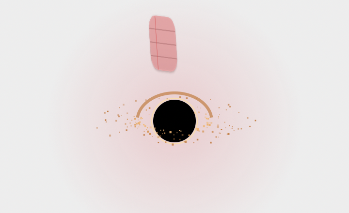

# Event Horizon

A small black hole for your Mac desktop. Drop files on it and they fall in. They go to the Trash.



*The image is a render of the app's own drawing code, mid-fall.*

## What it does

- The hole sits on the desktop, above the desktop icons and below your app windows. It is in the bottom-right corner by default.
- Drag files from Finder near the hole. The disk spins faster and a dashed ring shows the capture area.
- Drop the files on the hole. Each file spirals in, stretches and turns red, then disappears.
- Drag the hole across the desktop. It swallows the desktop icons it passes over. Hold Option to move the hole without swallowing.
- The hole grows with the total size of the items it holds.
- Double-click the hole to bring back the last item. The item flies out of the hole to its original folder.

## Safety

- Event Horizon never deletes files. It moves them to the Trash with the system Trash API.
- Finder does not delete or copy anything during the drop. The app moves the files itself.
- Sweeping takes only items in your Desktop folder. It never takes disks or other locations shown on the desktop. If you hide desktop icons in System Settings, sweeping is off.
- Bring back works last in, first out. If the original location has a new file with the same name, the app does not overwrite it. It shows an alert and keeps the item in the Trash.
- The app remembers swallowed items only while it runs. After you quit, use **Put Back** in the Finder Trash.

## Use

| Action | Result |
| --- | --- |
| Drop files on the hole | Moves them to the Trash |
| Double-click the hole | Brings back the last item |
| Drag the hole | Moves the hole and swallows the desktop icons it passes over. The app saves the position. |
| Option-drag the hole | Moves the hole only |
| Right-click the hole, or click the menu bar icon | Opens the menu |

The menu has these items:

- **Bring Back "name"**: brings back the last item.
- A summary line: the number of items and their total size.
- **Open Trash**
- **Move Hole to Corner**
- **Quit Event Horizon**

## Permissions

Sweeping needs two permissions. macOS asks for them the first time you sweep:

- **Automation > Finder.** Only Finder knows where the desktop icons are. The app asks Finder once, when the hole starts to move.
- **Desktop folder.** The app needs access to move the swept items to the Trash.

Dropping files on the hole needs no permission.

## Performance

The hole draws only while something moves: a drag near the hole, a fall, or a bring back. A display link starts for the animation and stops when everything is still. At rest, the window keeps its last frame.

Measured on macOS 27.2 (Apple silicon):

- Idle CPU: about 0%. The process used 10 ms of CPU time in 30 seconds.
- Memory footprint: about 14 MB.

## Requirements

- macOS 14 or later
- Swift 6 toolchain (Xcode or the Command Line Tools)

## Build and run

1. Build the app bundle:

   ```sh
   make app
   ```

2. Open it:

   ```sh
   open "build/Event Horizon.app"
   ```

3. To copy the app to `/Applications`:

   ```sh
   make install
   ```

The app has no Dock icon. It does not start at login.

Other targets:

- `make build`: debug build with SwiftPM.
- `make test`: runs the unit tests.
- `make clean`: removes build output.

## How it works

The app uses two transparent, borderless panels:

- **Effects panel.** A large panel that ignores the mouse. It draws the hole, the disk and the items in flight.
- **Target panel.** A small round panel over the hole. It accepts file drops, moves the hole and handles the double-click. macOS sends clicks through fully transparent pixels, so the panel fills its circle with an almost invisible color. Clicks outside the circle reach the windows below.

To react before the drop, the app watches mouse drags with a global event monitor. When the drag pasteboard holds file URLs, the pull grows as the cursor comes near the hole. Global mouse monitors need no special permission.

To sweep, the app runs `osascript` once when the hole starts to move. Finder returns the URL and the icon center of each desktop item. The child process exits after the lookup, so the app does not keep the AppleScript runtime in memory.

## Project layout

```
Sources/
  HorizonCore/        Physics and Trash logic, no UI
    Physics.swift       Hole size, pull strength, fall and eject paths
    TrashService.swift  Move to Trash, bring back, folder size
    DesktopSweep.swift  Parse Finder icon positions, find the icons the hole catches
  EventHorizon/       The AppKit app
    main.swift
    AppDelegate.swift       Menu bar item and menu
    HorizonController.swift Windows, position, drag pull, Trash actions
    HoleView.swift          Drawing and the frame loop
    DropTargetView.swift    Drops, moving the hole, double-click
    DesktopItems.swift      Asks Finder for the desktop icon positions
    Panels.swift            The floating panel
Tests/HorizonCoreTests/  Unit tests for physics, the Trash service and sweeping
Resources/Info.plist
scripts/bundle.sh        Builds the .app bundle
```

The Trash tests use the real Trash. They create temporary files, move them to the Trash, and remove them after the test.
